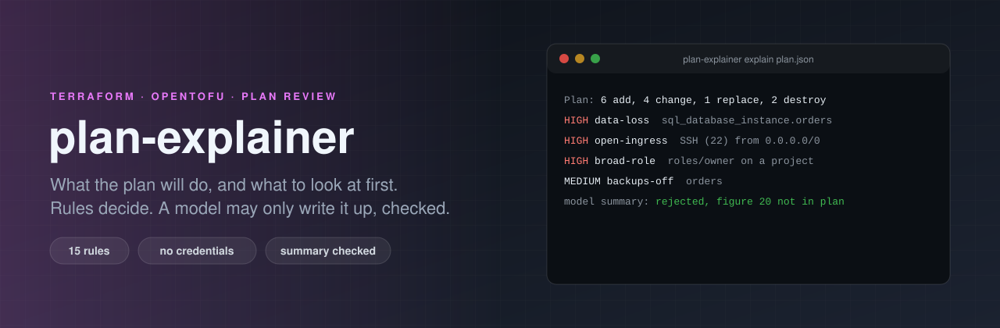
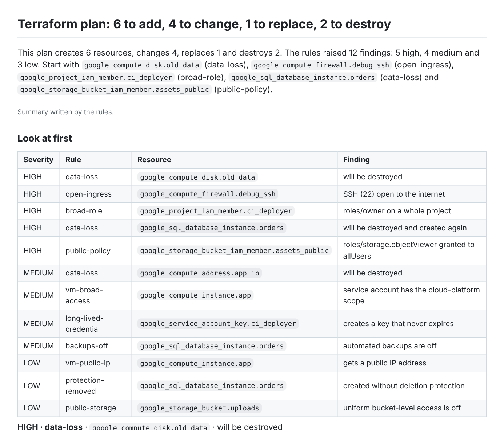

<p align="center">
  
</p>

# plan-explainer

[](https://github.com/ErenOzgu/plan-explainer/actions/workflows/ci.yml)


[](LICENSE)

`terraform plan` prints everything. A reviewer needs three answers: **what does this change, what can I not undo, and what did someone just open to the internet?** This tool reads the plan as JSON and answers them.

1. **Rules decide.** 15 rules, plain Python, read the planned values: a database that is destroyed, a firewall that lets `0.0.0.0/0` reach SSH, `roles/owner` on a whole project, a bucket that `allUsers` can read. Each finding says what, why it matters, what to do, and which values it saw.
2. **Replaced is not changed.** The report separates in-place changes from replacements, names the argument that forces each replacement, and says why a resource is destroyed (removed from the configuration, `count` shrank, a `for_each` key went away).
3. **A model may write the summary, and is checked.** With `--llm` a model writes a few sentences from the findings. They are used only if every resource address exists in the plan, every figure is in the facts, every high-severity finding is mentioned, and nothing sounds reassuring. Otherwise the rules' own summary is used, and the report says why.

Without `--llm` there is no model at all.

<p align="center"></p>

```sh
pip install git+https://github.com/ErenOzgu/plan-explainer

terraform plan -out=tfplan
terraform show -json tfplan > plan.json         # tofu works the same way

plan-explainer explain plan.json                          # to the terminal
plan-explainer explain plan.json -f md -o plan.md         # for a PR comment
plan-explainer explain plan.json --fail-on high           # exit 3 if a finding is high or above
plan-explainer explain plan.json -c plan-explainer.toml   # waivers, extra stateful types
ANTHROPIC_API_KEY=... plan-explainer explain plan.json --llm
plan-explainer rules                                      # what it checks
```

The report in the picture is [`examples/reports/webshop.md`](examples/reports/webshop.md), made from [`examples/plans/webshop.json`](examples/plans/webshop.json) (see *How it is tested* for what that file is). A plan with nothing to flag is [`examples/reports/tidy.md`](examples/reports/tidy.md), and says so without saying *safe*.

## In a pipeline

```yaml
- run: terraform plan -input=false -out=tfplan
- run: terraform show -json tfplan > plan.json
- run: pip install git+https://github.com/ErenOzgu/plan-explainer
- name: Explain the plan
  run: plan-explainer explain plan.json -f md -o plan.md --github-summary --annotate --fail-on high
- name: Comment on the pull request
  if: always() && github.event_name == 'pull_request'
  env:
    GH_TOKEN: ${{ github.token }}
  run: gh pr comment "${{ github.event.pull_request.number }}" --body-file plan.md
```

`--github-summary` appends the report to the job summary, and `--annotate` turns each finding into an Actions annotation (error for high, warning for medium, notice for low). `--fail-on` fails the job *after* the report is written, so the reviewer still gets it. The comment step needs `pull-requests: write`.

## The rules

<!-- rules:start -->
| Rule | Severity | What it catches | Resources |
|---|---|---|---|
| `authoritative-iam` | medium / low | An IAM resource that owns a whole policy (_iam_policy) or a whole role (_iam_binding): members not listed are removed. | google_*_iam_policy, google_*_iam_binding |
| `backups-off` | medium | Automated backups are switched off for a database. | google_sql_database_instance, aws_db_instance, aws_rds_cluster |
| `broad-role` | high / medium | Grants owner, editor, or an IAM-admin role on a whole project, folder or organization; or an AWS policy that allows every action on every resource. | google_(project|folder|organization)_iam_*, aws_iam_*policy*, aws_iam_*_policy_attachment |
| `data-loss` | high / medium | A resource that holds data (databases, buckets, disks, keys, secrets, reserved IPs, DNS zones) is destroyed or replaced. | 40 types in Google Cloud, AWS and Azure; more with `stateful_types` in the config |
| `long-lived-credential` | medium | A service-account key or an access key is created: a credential that does not expire. | google_service_account_key, aws_iam_access_key |
| `mass-destroy` | medium | Many resources are destroyed or replaced in one plan (10 by default; `mass_destroy` in the config). | the whole plan |
| `no-final-snapshot` | high | A database is destroyed with skip_final_snapshot = true, so nothing is kept. | aws_db_instance, aws_rds_cluster, aws_redshift_cluster |
| `open-ingress` | high / medium / low | Lets the whole internet (0.0.0.0/0 or ::/0) reach SSH, RDP, a database port, all ports, or other non-web ports. | google_compute_firewall, aws_security_group, aws_security_group_rule, aws_vpc_security_group_ingress_rule |
| `protection-removed` | medium / low | Deletion protection is switched off on an existing resource, or a database or cluster is created without it. | google_sql_database_instance, google_container_cluster, google_bigquery_table, aws_db_instance, aws_rds_cluster, aws_lb, aws_dynamodb_table |
| `public-endpoint` | high / medium | A database, cluster API or similar endpoint that is reachable from the internet. | google_sql_database_instance, google_container_cluster, aws_db_instance, aws_rds_cluster_instance, aws_redshift_cluster, aws_eks_cluster |
| `public-policy` | high | Grants access to allUsers or allAuthenticatedUsers (Google Cloud), or to Principal "*" with no condition (AWS policy documents). | google_*_iam_member / _binding / _policy, aws_* with policy or assume_role_policy |
| `public-storage` | high / medium / low | A bucket with a public ACL, with S3 public-access blocks switched off, or without uniform bucket-level access. | aws_s3_bucket, aws_s3_bucket_acl, aws_s3_bucket_public_access_block, google_storage_bucket |
| `unencrypted` | medium | Storage that is explicitly created with encryption switched off. | aws_ebs_volume, aws_efs_file_system, aws_redshift_cluster, aws_db_instance, aws_rds_cluster |
| `vm-broad-access` | medium | A VM whose service account has the cloud-platform scope: every API, limited only by the account's IAM roles. | google_compute_instance, google_compute_instance_template |
| `vm-public-ip` | low | A VM gets a public IP address. | google_compute_instance, aws_instance |
<!-- rules:end -->

Severities are about the plan, not about your estate: *high* means "stop and look before applying", not "this is a vulnerability". The rules read what Terraform plans to set, so a value that is only known after apply (a computed address, a reference to something not created yet) is not judged, and says nothing.

### Waivers

```toml
# plan-explainer.toml
stateful_types = ["acme_widget"]        # more types that hold data (data-loss)
mass_destroy = 10                       # how many destroys make a plan suspicious

[[waive]]
rule = "open-ingress"
address = "google_compute_firewall.iap_*"      # an address, or a pattern with * and ?
reason = "IAP TCP forwarding range, restricted by the IAP-secured tag"
```

A waiver needs a reason, and an unknown rule or key is an error. A waived finding is **not hidden**: it moves to the notes with its reason, so the next reader sees what was accepted and why. A waiver that matches nothing is reported too, so stale ones get removed.

## The checked summary

With `--llm` the model is given the facts as plain lines: the counts, each changed resource with its action (and the *names* of the arguments that force a replacement), and each finding's rule, address and title. It is asked for three to five sentences. Then `check_text` decides:

| Check | What is rejected |
|---|---|
| **Addresses exist** | a resource address that is not in the plan (`google_compute_instance.database` when the plan has no such resource) |
| **Figures are in the facts** | a number that is not in what the model was given (`destroys 20` when the plan destroys 2). Digits inside resource names are not figures |
| **High findings are mentioned** | a text that leaves out the resource of a high-severity finding |
| **No reassurance** | *safe*, *harmless*, *low-risk*, *no concerns*, *looks fine*: a rule engine with a fixed list cannot promise that |
| **No destroy talk without a destroy** | *destroy*, *delete*, *remove* when nothing is destroyed or replaced |
| **Short** | more than 1,200 characters |

A text that fails is replaced by the rules' summary. The report says so (`A summary written by claude-sonnet-5-5 was rejected (the figure 20 is not in the facts) and replaced by the rules' summary`), `--format json` keeps the rejected text, and the CLI prints the reason on standard error. The rules' own summary passes the same check for every combination of seven different kinds of change (a test goes through all 128).

## What the model sees, and what is never printed

- **The model sees addresses, actions and finding titles, and nothing else.** A title can name a role or a port (`roles/owner on a whole project`, `SSH (22) open to the internet`), and an address is whatever you named the resource. It never sees an argument value: not an IP range, an email address, a machine type or a secret. A test sends the example plan, whose values include `0.0.0.0/0`, an IP address, a service-account address, a machine type and two secrets, and searches the whole request body for them.
- **Values Terraform marks as sensitive are never printed**, in any format. Terraform does not mark everything, so a second layer hides anything under a name like `password`, `secret`, `token`, `private_key`, `credential` or `api_key`. The recorded OpenTofu plan in `tests/real/structure.json` shows why the second layer exists: `terraform_data.output` carries a sensitive input without the mark, and the report prints `"token": "(sensitive)"` for it.
- `--no-values` prints only the *names* of changed arguments, never values, for a public repository or a shared log.
- Anything from the plan that goes into markdown is escaped: HTML, `|`, line breaks, `@mentions`. Plan values only appear inside code spans or escaped.

## How it is tested

The tests say what kind of evidence each claim rests on.

- **Real plans.** `tests/real/` holds plans recorded from a real OpenTofu run (`record.sh`): create, update, replace, destroy, `create_before_destroy`, `count`, `for_each`, a module, a sensitive value, an output. CI records the same scenarios again with **Terraform 1.9.8** and requires the same resources, actions, reasons and forcing arguments as the committed ones.
- **A real provider.** CI plans [`examples/terraform/risky`](examples/terraform/risky/main.tf) with the real Google provider (a dummy token, nothing is created) and requires the findings to be exactly [`expected.txt`](examples/terraform/risky/expected.txt), no more and no fewer. [`clean`](examples/terraform/clean/main.tf) must produce none and pass `--fail-on low`.
- **Hand-written plans.** The Google resources in `examples/plans/` and the rule tests are built by hand in the exact `terraform show -json` shape ([`make_plans.py`](examples/make_plans.py)), because destroy and replace of a Cloud SQL instance cannot be recorded without a project. They show the report; the real-provider job above is what shows the rules work on what the provider really produces.
- **Every rule has positive and negative cases**, including the near misses: ports 80 and 443 open to the world (not a finding), `serviceAccountUser` on one service account (not a finding), a policy with a condition, a disabled firewall, a destroy of the firewall itself.
- **The model path is tested against a local fake server** shaped like the Messages API: a good text is used; a made-up address, figure or direction fails; a reassuring text fails; an API error and an unreachable server fall back without raising; the request is inspected. No test calls the real API. With a real key the behaviour is the same code, but that is not something CI can show.
- **Rendering**: the committed reports are diffed against what the tool writes today; two runs are byte-identical, in any input order; hostile values are escaped.

## What it cannot do

- **It is not a review.** The rules cover a fixed list of risks. "No findings" means *none of these 15*, and the report says so every time. It does not know your architecture, your threat model or your organisation's policies.
- **It reads the plan, not the world.** It cannot tell that a firewall's source range is a public address you actually own, that a bucket is empty, or that a database has a backup elsewhere.
- **Unknown values are not judged.** If a security-relevant value is only known after apply, the rule stays silent.
- **A checked summary can still be wrong.** The check proves that addresses and figures exist and that the high findings are named. It cannot prove the sentences describe them correctly. That is why the findings table, which the rules write, always comes first.
- **Providers**: the rules know Google Cloud best, AWS well enough for the common cases, and Azure only for the data-loss list. Add types with `stateful_types`; other rules need code.
- **Plan format**: Terraform and OpenTofu plan JSON, format 1.x. A binary plan file has to go through `terraform show -json` first.

## Layout

```
plan_explainer/
  model.py       the plan as data: changes, actions, reasons, forcing arguments, sensitivity masks
  values.py      walking values with their masks; hiding what is sensitive
  rules.py       the 15 rules
  config.py      stateful types, waivers with reasons
  analysis.py    run rules, apply waivers, the rules' summary
  llm.py         the optional model call, and the checks its text has to pass
  report.py      markdown, text, JSON
  cli.py
examples/        plans (generated), reports (committed), real Terraform configurations
tests/real/      plans recorded from a real run, and the script that records them
```

## License

MIT, see [LICENSE](LICENSE).
